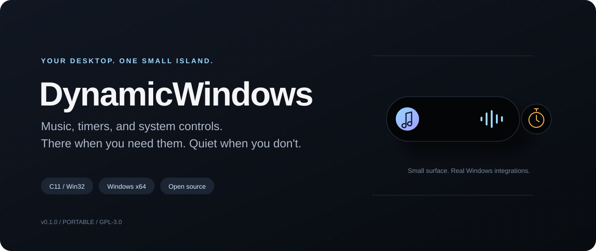
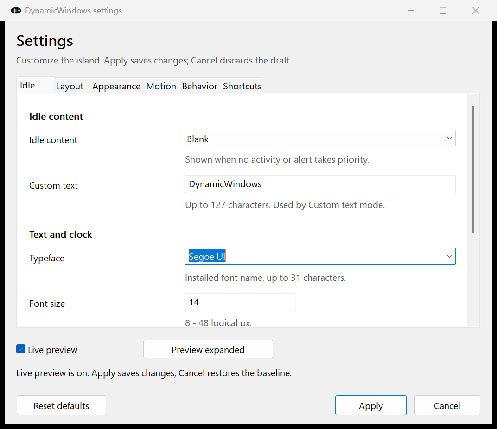

<p align="center">
  
</p>

<p align="center">
  <a href="https://github.com/SauloHS/DynamicWindows/releases/latest"></a>
  
  
  <a href="LICENSE"></a>
</p>

<h1 align="center">DynamicWindows</h1>
<p align="center"><strong>A small island for the things happening on your PC.</strong></p>
<p align="center">Music. Timers. Volume. Power.<br />Native Windows controls, fluid motion, and a desktop that stays yours.</p>

<p align="center">
  <a href="https://github.com/SauloHS/DynamicWindows/releases/latest"><strong>Download for Windows</strong></a>
  &nbsp;·&nbsp; <a href="#make-it-yours">Customization</a>
  &nbsp;·&nbsp; <a href="#build-from-source">Build from source</a>
  &nbsp;·&nbsp; <a href="https://github.com/SauloHS/DynamicWindows/issues">Report a bug</a>
</p>

---

## A little less window switching

DynamicWindows brings a Dynamic Island-inspired activity surface to **Windows 10 and 11**. It sits near the top of your display, gives you quick access to what is happening, and gets out of the way when you are done.

**One portable executable. No Electron. No web runtime. No account.**

- **Your music, within reach.** Read the current Windows media session, see artwork, play or pause, skip tracks, and seek when the player supports it.
- **Small by default.** A blank 80 × 28 logical-pixel pill becomes an artwork-and-waveform surface during playback. Changes briefly reveal the title without leaving a big panel open.
- **A timer that stays visible.** Start, pause, resume, or reset a countdown. Simultaneous media and timer activity can split into two bubbles.
- **System controls without the detour.** Adjust volume and mute, see power changes, and open the actual Windows Search panel.
- **Headphones, without guessing.** Connection and disconnection alerts for wired/USB headphones and Bluetooth audio, plus battery levels when Windows reports them.
- **Motion with continuity.** Interruptible springs, adjustable damping, and slide-and-fade hide/show transitions. Windows' reduced-motion setting is respected.
- **Yours to configure.** Eight native settings tabs, live preview, saved preferences, monitor placement, colors, notifications, Crab, and customizable shortcuts.

> **Early release:** v0.1.0 is a usable first version, not a finished operating-system component. Media support depends on what your player exposes to Windows. Bug reports with reproduction steps are welcome.

## Unreleased

The source branch adds headphone/Bluetooth integration beyond the published v0.1.0 downloads. Build from source to use it; existing release assets have not been replaced.

## Get started

1. Open **[Releases](https://github.com/SauloHS/DynamicWindows/releases/latest)**.
2. Download **`DynamicWindows-0.1.0-windows-x64.zip`** and extract it into a folder you want to keep.
3. Run **`DynamicWindows.exe`**. No installer or administrator privileges are required.
4. Play music, click the island, or press **Ctrl + Alt + D**.
5. Open settings with **Ctrl + Alt + C**, the island's gear button, or **right-click → Customize DynamicWindows**.

The initial setup uses a blank **80 × 28** idle pill, a **36 px** media width increase, no border or camera-style dot, and an adjustable 120 FPS animation target. Settings do not open automatically at startup.

The release is **unsigned**. Windows may display a SmartScreen or publisher warning. Verify the repository and the release checksum before choosing whether to run it; do not disable Windows security features. Managed PCs may require administrator approval under organizational policy.

### Default shortcuts

| Action | Shortcut |
|---|---|
| Open or collapse the island | **Ctrl + Alt + D** |
| Open the countdown timer | **Ctrl + Alt + T** |
| Hide or show the island | **Ctrl + Alt + H** |
| Open settings | **Ctrl + Alt + C** |
| Open Windows Search | **Ctrl + Alt + F** |
| Start or cancel Crab | **Ctrl + Alt + Space** |
| Collapse the focused island | **Escape** |
| Switch to media / timer / system | **1 / 2 / 3** |
| Open settings from the focused island | **F2** or **Ctrl + Comma** |
| Play/pause from the media panel | **Space** |
| Adjust a focused slider | **Left / Right**, **Home / End** |

Every app shortcut above can be changed in **Shortcuts**. Enter `None` to disable a binding. Duplicate bindings in the same scope are rejected. If another app owns a global shortcut, choose a different one.

**Tab / Shift + Tab** and **Enter / Space** button activation remain standard keyboard navigation. Settings also supports **Ctrl + Tab**, **Ctrl + Page Up / Down**, and **Ctrl + S** for tab switching and Apply.

## How the island behaves

### Music

The compact media pill uses **idle width + media extra width**, idle height, and idle corner settings. Its circular artwork shrinks to fit smaller heights. The waveform represents the **default system output**, not isolated audio from one application.

A track, artist, playback-state, or seek change briefly displays the title. After the preview timeout, the title fades away; the pill keeps the same compact geometry. Click or hover to open the full player.

The expanded player uses **dimmed album artwork as its background**, with a readable track title, artist, and friendly app label such as “Spotify.” Disable **Artwork background** to use a separate cover instead.

Playback position combines the player's timeline timestamp with a continuous local clock. Source-app updates and accuracy are still subject to Windows media support. Controls the source app does not support are disabled rather than simulated.

### Hide, without missing every change

The hide shortcut slides and fades the island away. Supported media changes, timer events, volume changes, and power alerts briefly reveal a hidden island, then restore its hidden state.

Full-screen suppression takes priority. Clicking a temporary preview explicitly opens the island. Clicking outside a manually opened island collapses it without blocking the outside click.

### Headphones and Bluetooth

Connecting headphones shows an original earbud illustration, a small connection label above the device name, and a circular Bluetooth battery meter. After the preview, the compact idle pill keeps the earbud icon and battery ring. When media or a timer is active, that activity keeps the main pill and earbuds move into a circular side bubble whose diameter matches the current pill height. Media and timers always outrank earbuds.

Bluetooth audio includes a percentage only when its Windows driver publishes one. Missing battery data uses a neutral ring and `?` in the larger preview, never a fabricated zero. Windows can expose some Bluetooth speakers through the same audio endpoint path. The earbud SVG is original artwork embedded in the executable, not an Apple asset.

Detection follows active Windows audio endpoints and matches Bluetooth device properties by physical container identity, not by a guessed device name. Wired jack detection depends on the audio driver exposing headphone/headset state. The first scan establishes a baseline without replaying existing connections. Battery changes update the compact ring silently.

Use **Behavior → Headphones and Bluetooth** to control alerts, persistent compact status, battery visibility, and alert duration. The System panel keeps connected device information available. All device discovery runs on a worker; no pairing, drivers, microphone capture, or network access is needed.

### App notifications

Notification mirroring is **off by default**. It requires the optional MSIX install because Windows gates `UserNotificationListener` behind package identity and the `userNotificationListener` capability. Open **Notifications → Request Windows access**; Windows owns the permission prompt and can deny or revoke access.

Allowed toast notifications briefly appear on the island and remain available in the expanded **Alerts** view. Source-only mode hides title/body content. DynamicWindows only reads notifications when enabled; it does not dismiss or modify the originals. The portable executable continues to work, but cannot access this protected API.

### Crab voice assistant

Crab is an **opt-in** native voice assistant. Enable it in **Crab**, choose an API format, set a base URL and model, then connect an API key when the endpoint requires one. Press **Ctrl + Alt + Space** and say the configured wake name followed by a question—for example, “Crab, what’s 1 + 1?” Change the wake name to “Siri” or another phrase if preferred.

Activation morphs the island into an original liquid-glass orb. Cyan, violet, and magenta layers distinguish listening, thinking, and speaking without relying on text; reduced motion uses a stable glass state. Windows Speech Recognition performs local transcription. Crab supports **Anthropic Messages** and **OpenAI-compatible Chat Completions** endpoints, including local Ollama-style servers. Windows text-to-speech can read answers aloud.

The API key is stored in **Windows Credential Manager**, never `settings.ini`, and isolated by API format plus normalized base URL. Crab sends only the recognized question to the configured endpoint after activation. HTTPS is required for remote endpoints; plain HTTP is accepted only for `localhost`, `127.0.0.1`, or `::1`. It has no OS-control tools and cannot claim to have performed actions. Microphone capture starts only from the Crab shortcut, not continuously in the background. Press the shortcut again or click the orb to cancel.

### Timers and system activity

Choose a 1-, 5-, 15-, or 25-minute preset, or set a different initial duration in settings. Completion produces an alert and optional sound. Timers use a monotonic deadline, including after sleep, but **do not survive quitting the app**.

Volume and power use Windows APIs. Desktop PCs without a battery display that state honestly. There is no invented battery percentage.

## Make it yours

Open settings with **Ctrl + Alt + C**, **right-click → Customize DynamicWindows**, the gear button, or:

```powershell
.\DynamicWindows.exe --settings
```

| Tab | What you can change |
|---|---|
| **Idle** | Clock, date, custom text, battery, volume, blank or hidden; typeface; clock format; decorative camera-style dot. |
| **Layout** | Idle dimensions, timer dimensions, expanded dimensions, media width increase, corner radii, bubbles, alerts, monitor, nine anchors, and offsets. |
| **Appearance** | RGB colors and native color pickers, opacity, border thickness, and shadow. |
| **Motion** | Response time, spring damping, animation frame-rate target, and reduced motion. |
| **Behavior** | Activity visibility, artwork background, waveform, media details, preview duration, volume/power alerts, hover delays, timer sound, and full-screen hiding. |
| **Shortcuts** | Global and local key bindings, with duplicate validation and optional disabling. |
| **Notifications** | Explicit Windows permission, source-only privacy mode, preview duration, and current access status. |
| **Crab** | Voice-assistant opt-in, wake name, Claude model, spoken replies, and secure API-key connection. |

<p align="center"></p>

**Live preview** changes the island without saving. **Apply** saves a new baseline. **Cancel** restores the last applied configuration. **Reset defaults** resets the draft, not your saved file.

All sizes are **logical pixels**. The renderer adapts to display DPI and constrains placement to keep controls reachable. The legacy media width/height settings are retained for configuration compatibility; compact playback and brief title previews follow idle geometry.

### Your settings stay on your PC

Preferences are saved in:

```text
%LOCALAPPDATA%\DynamicWindows\settings.ini
```

The shipped preset is documented in [`resources/defaults.ini`](resources/defaults.ini). It is also compiled into the app: you do not need to copy a configuration file to get the defaults.

Use a separate profile when needed:

```powershell
.\DynamicWindows.exe --config C:\path\my-island.ini --settings
```

### Optional notification-capable MSIX

Build the app, then create an unsigned MSIX package:

```powershell
powershell -NoProfile -ExecutionPolicy Bypass -File packaging\build-msix.ps1
```

MSIX installation requires a trusted code-signing certificate. Pass its exact subject with `-Publisher`, then sign the generated package with `signtool.exe`. Do not install an unsigned package or disable signature enforcement. The portable executable remains the simplest build when notification access is not needed.

## Privacy, honestly

- No background app network requests, telemetry, accounts, or cloud configuration. Crab contacts only the configured provider endpoint after explicit activation.
- No continuous microphone capture, audio recording, camera access, or screen recording.
- Crab uses the microphone only after explicit shortcut activation and sends the recognized question to the configured provider when enabled.
- No notification access unless explicitly enabled and granted by Windows.
- Media metadata comes from **Windows GSMTC**. The waveform uses an audio-output peak meter.
- An outside-click listener is active for manually opened controls; it closes the island without swallowing the click.
- The optional development GUI checks take screenshots. Those files are local test output, not part of the release.

The camera-style dot is **decorative**. It is not a camera privacy indicator.

## What v0.1.0 does not do

DynamicWindows is an independent Windows app—not Apple software, a Windows shell replacement, or a complete iOS/macOS port.

- Notification Center mirroring requires the optional MSIX package and explicit Windows permission; the portable executable cannot request this protected capability.
- It does not integrate Siri, AirDrop, phone calls, Face ID, delivery tracking, or third-party Live Activities.
- It does not reserve desktop space. The overlay can overlap app toolbars; move it or hide it when needed.
- It cannot appear on Windows' secure desktop or lock screen.
- It does not enable automatic startup or update itself.
- Windows on ARM is not a native build target for this release.

Notification access is never silently enabled. Windows owns the permission prompt, and source-only mode can keep toast text out of the island.

## Build from source

**Toolchain:** Windows x64, MinGW-w64 GCC, CMake 3.20+, Ninja, and clang-format. No downloaded application framework is required.

```powershell
git clone https://github.com/SauloHS/DynamicWindows.git
cd DynamicWindows
cmake -S . -B build -G Ninja -DCMAKE_C_COMPILER=gcc -DCMAKE_RC_COMPILER=windres -DCMAKE_BUILD_TYPE=Release
cmake --build build
.\build\DynamicWindows.exe
```

If GCC is not on PATH, pass full compiler paths, for example `C:/mingw64/bin/gcc.exe` and `C:/mingw64/bin/windres.exe`. Do not reuse a build directory configured for another compiler.

The executable links the compiler runtime statically and uses Windows system DLLs. It does not need MinGW DLLs installed on the target PC. MinGW is required for this build because its GDI+ headers expose the flat C API.

### Development checks

```powershell
cmake --build build --target typecheck
ctest --test-dir build --output-on-failure
cmake --build build --target lint
```

- **Core tests:** countdown deadlines, pause/resume, priority, geometry, and frame-rate-independent springs.
- **Configuration tests:** defaults, Unicode persistence, limits, placement, malformed input, and notification privacy defaults.
- **Notification tests:** duplicate suppression, baseline handling, text sanitation, bounded history, and permission-state labels. They do not request permission or read real notifications.
- **Headphone tests:** connection/disconnection deltas, Bluetooth identity, validated battery values, unavailable battery text, and bounded events. No mouse, audio changes, or hardware required.
- **Crab tests:** wake-name parsing, JSON escaping, Messages API text extraction, and state labels. They do not use microphone, network, credentials, speech, or GUI.
- **Native smoke:** renders representative states and checks alpha hit-testing and accessibility names/roles.

Optional GUI checks require Python 3 and an interactive Windows desktop. They move the pointer, foreground the test app, and save local screenshots. The settings check also verifies the Notifications and Crab pages without pressing permission or API-key buttons. Quit any existing instance first, and do not share screenshots containing private desktop content.

```powershell
python -I tests/gui_check.py build/DynamicWindows.exe build/smoke --settings
python -I tests/gui_check.py build/DynamicWindows.exe build/smoke --search
python -I tests/gui_check.py build/DynamicWindows.exe build/smoke --live-media
```

The live-media check uses an included native test publisher. It publishes a real Windows media session but does not play or capture audio.

### Useful launch options

```powershell
.\DynamicWindows.exe --settings
.\DynamicWindows.exe --view timer
.\DynamicWindows.exe --view system --reduced-motion
.\DynamicWindows.exe --run-for 10
.\DynamicWindows.exe --help
```

`--demo` explicitly simulates a media session for development. Normal operation never fills missing activity with fake data.

## Troubleshooting

<details>
<summary><strong>Nothing appears to happen after launch</strong></summary>

The default idle pill is intentionally small and blank. Look near the top center of the primary display, press **Ctrl + Alt + D**, or right-click the system tray icon. A hidden/full-screen state or a conflicting shortcut can also affect visibility.

</details>

<details>
<summary><strong>Music, artwork, or seeking is missing</strong></summary>

Play something in a source app that exposes Windows media controls. DynamicWindows follows the current GSMTC session. Not every player publishes artwork, duration, seeking, or transport capabilities. Unsupported controls are disabled. Include the source app and Windows version in a bug report.

</details>

<details>
<summary><strong>A shortcut does not work</strong></summary>

Another app or Windows may own it. Open settings from the tray icon and select another binding in **Shortcuts**. Standard keyboard navigation remains available.

</details>

<details>
<summary><strong>How do I uninstall it?</strong></summary>

Quit from the tray menu and delete the folder containing the executable. Optionally remove `%LOCALAPPDATA%\DynamicWindows` to delete saved settings. There is no installer or automatically created startup entry to undo.

</details>

## Contributing

Small, focused fixes are welcome. For a bug report, include:

1. Windows version and display scaling.
2. The player or app involved, if relevant.
3. Reproduction steps, expected behavior, and actual behavior.
4. A cropped screenshot or recording **without private content**.

Build with the warning-as-error flags, run the checks relevant to your change, and keep the implementation native C. Please discuss large integrations in an issue before introducing a new framework or service.

If the app earns a place on your desktop, a star helps other people find it.

## License

Copyright © 2026 DynamicWindows contributors. Released under the **[GNU General Public License v3.0](LICENSE)**. You may use, modify, and redistribute it under the license's terms. Distributed derivatives must preserve the applicable GPL obligations and provide corresponding source.

**There is no warranty.** See the license for the full terms.

Windows, Spotify, and Apple product names belong to their respective owners. DynamicWindows is not affiliated with or endorsed by them. The banner and interface icons are original; no Apple logos or bundled proprietary fonts are used.
